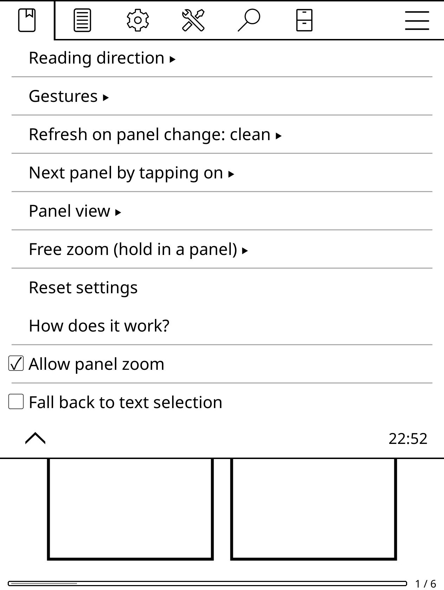
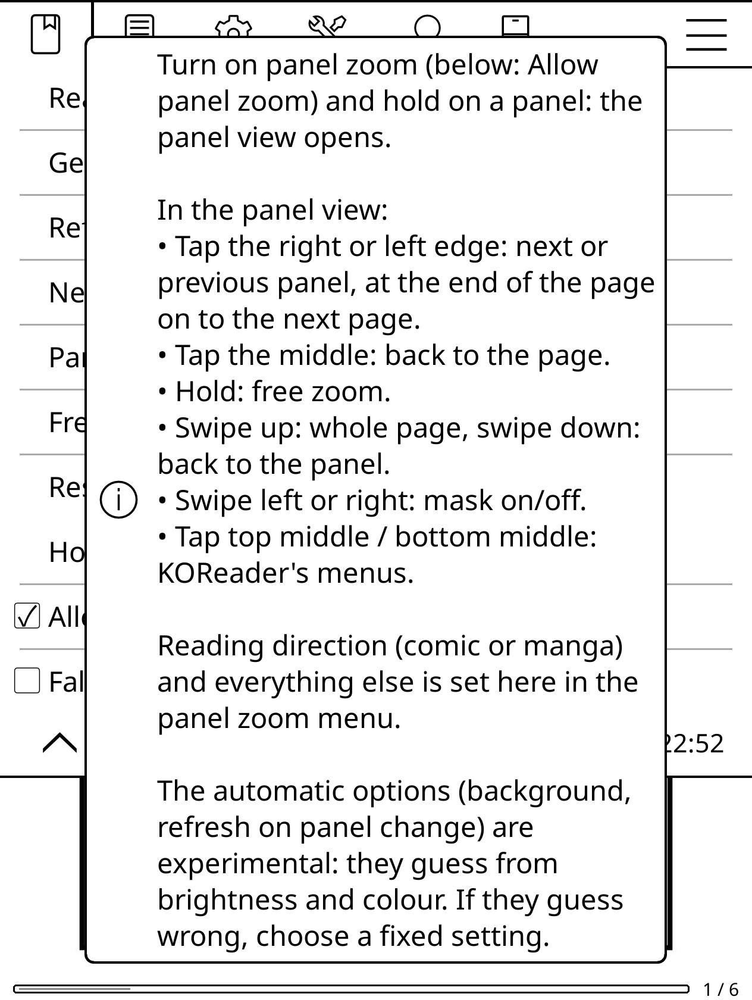
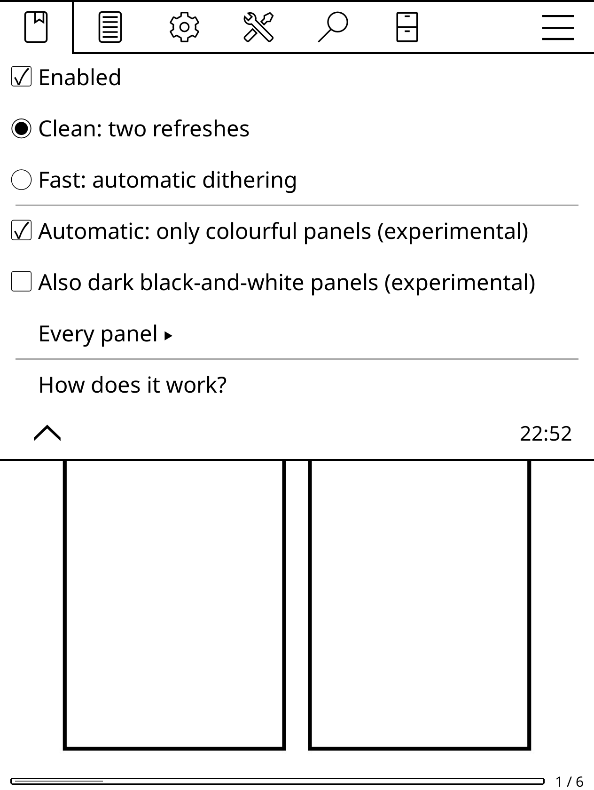
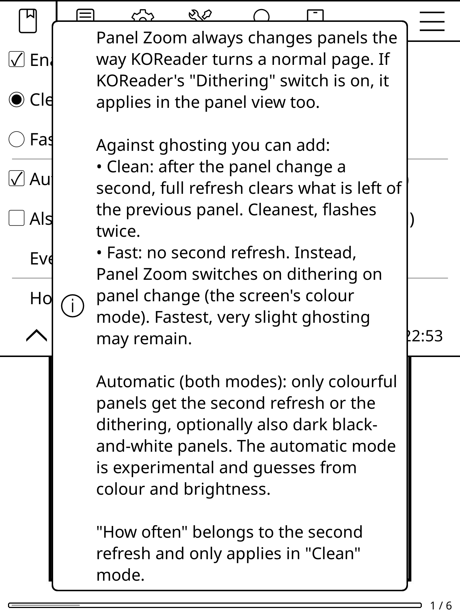
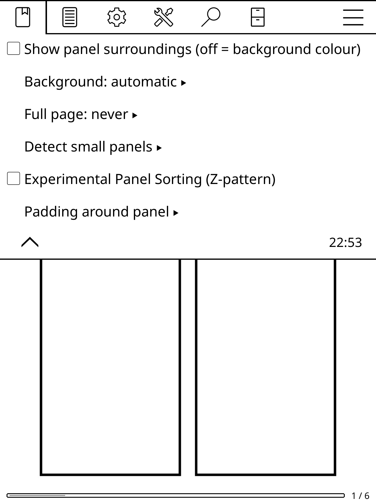

# Comic Panel Zoom für KOReader

*English: [README.md](README.md)*

<!-- lang-note -->
*Funktioniert auf **Deutsch und Englisch**: Menüs und Texte richten sich nach der KOReader-Sprache.*

> **Basiert auf [Dynamic Panel Zoom](https://github.com/JorgeTheFox/koreader-dynamic-panelzoom) von [JorgeTheFox](https://github.com/JorgeTheFox)** (MIT-Lizenz).
> Die Panel-Erkennung, die Panel-Ansicht und die Grundidee stammen vom Original. Dies ist eine inoffizielle, umbenannte und erweiterte Fassung. Alle Credits für das Original-Plugin gehören seinen Autoren. Wenn es dir gefällt, gib bitte auch dem Original einen Stern.

Eine Panel-für-Panel-Ansicht für Comics und Manga mit automatischer Panel-Erkennung. Alle Einstellungen stehen im normalen Panel-Zoom-Menü von KOReader.

## Was anders ist als im Original

- Es läuft mit KOReader ab 2026.07.1. Der Fix stammt aus dem Code des Original-Projekts, wurde aber nie veröffentlicht.
- Es ist umbenannt (Ordner, Plugin-Name und internes Modul `cpz_panel_viewer.lua`) und kollidiert deshalb nie mit Updates des Originals.
- Neue Funktionen:
  - Start beim angetippten Panel.
  - Seitenübersicht per Wischen, auf Wunsch mit Rahmen um das aktuelle Panel.
  - Maske an/aus per Wischen.
  - Schwarzer, weißer oder automatischer Hintergrund.
  - Refresh beim Panelwechsel gegen Ghosting.
  - Leserichtung pro Comic plus Standard für neue Comics.
  - Ganze Seite vor dem ersten und/oder nach dem letzten Panel.
  - Einstellbare Mindestgröße für Panels.
  - KOReaders Rand-Gesten und das Plugin [LiveLight](https://github.com/ironicsans/livelight.koplugin) funktionieren auch in der Panel-Ansicht.
  - Menüs lassen sich aus der Panel-Ansicht öffnen.
  - Deutsche Menütexte.
- Fehlerbehebungen: ein Notausgang (Tipp in die Mitte schließt immer) und keine übersprungenen Panels mehr beim Vorladen.

## Bildschirmfotos

*Die Bildschirmfotos zeigen die englische Oberfläche; in einem deutschen KOReader sind die Texte deutsch.*

<table>
<tr><td align="center" valign="top" width="33%"> Panel-Zoom-Menü: Leserichtung, Gesten, Refresh beim Panelwechsel, freier Zoom</td><td align="center" valign="top" width="33%"> Hilfetext zur Panel-Ansicht und ihren Tipp-Zonen</td><td align="center" valign="top" width="33%"> Refresh beim Panelwechsel: sauber, schnell, automatisch, wie oft</td></tr>
<tr><td align="center" valign="top" width="33%"> Hilfetext zu den zwei Refresh-Modi</td><td align="center" valign="top" width="33%"> Einstellungen der Panel-Ansicht: Umgebung, Hintergrund, ganze Seite, kleine Panels, Rand</td></tr>
</table>

## Installieren

1. Die ZIP-Datei unter [Releases](../../releases) herunterladen und entpacken, oder dieses Projekt herunterladen.
2. Im `plugins`-Ordner dürfen **nicht** liegen: das Original `dynamic_panelzoom.koplugin` und PanelsPlus. Alle drei ersetzen KOReaders Panel-Zoom und würden sich gegenseitig überschreiben.
3. Den Ordner **`comicpanelzoom.koplugin`** in KOReaders `plugins`-Ordner kopieren. Auf dem Kobo ist das `.adds/koreader/plugins/`.
4. KOReader neu starten.

## Benutzen

1. Einen Comic öffnen, Zoom auf „ganze Seite“ und Ansicht auf „Seite“ stellen (nicht fortlaufend).
2. Dann: oberes Menü → Dokument-Reiter → Panel-Zoom → **Panel-Zoom erlauben** einschalten. Dort stehen auch alle Einstellungen.
3. Die Panel-Ansicht öffnet sich, wenn du lange auf ein Panel drückst.

In der Panel-Ansicht:

| Aktion | Wirkung |
| --- | --- |
| Rand rechts oder links antippen | Nächstes oder vorheriges Panel. Am Seitenende geht es automatisch zur nächsten Seite. |
| Mitte antippen | Zurück zur Seite |
| Lange drücken | Freier Zoom |
| Nach oben / unten wischen | Seitenübersicht / zurück zum Panel |
| Nach links / rechts wischen | Maske an/aus |
| Oben Mitte / unten Mitte antippen | KOReaders Hauptmenü / Einstellungsmenü |
| Am linken oder rechten Rand ziehen | Helligkeit oder Wärme, wie beim normalen Lesen |

## Einstellungen (Panel-Zoom-Menü)

- **Leserichtung:** „Dieser Comic“ wird im Buch gespeichert, dazu ein „Standard für neue Comics“.
- **Gesten:** Übersicht, Rahmen und Masken-Wischen lassen sich einzeln abschalten.
- **Refresh beim Panelwechsel** (Aufbau wie bei Comic Display): immer KOReaders normaler Refresh beim Umblättern, KOReaders Dithering-Schalter gilt mit. Dazuschaltbar: *Sauber* (zweiter Refresh: jedes Panel, jedes 2./3./5., erstes Panel jeder Seite) oder *Schnell* (Dithering automatisch), mit Automatik (nur farbige Panels, auf Wunsch auch dunkle Schwarzweiß-Panels, experimentell).
- **Panel-Ansicht:** Umgebung zeigen, ganze Seite vorher und/oder nachher, Mindestgröße für Panels (1/8 bis 1/16 der Seite), Hintergrund (weiß, schwarz, automatisch), Rand.

Die Einstellungen liegen in `koreader/settings/comicpanelzoom.json`. Updates des Plugin-Ordners löschen sie also nicht.

## Passt gut zu

- [Comic Display](https://github.com/Akrota/koreader-comic-display): Refresh gegen Ghosting und dunkle Ränder neben der Seite.
- [Comic Dual Page](https://github.com/Akrota/koreader-comic-dual-page): zwei Seiten nebeneinander im Querformat.

## Getestet auf

Kobo Libra Colour mit KOReader 2026.07.1 (auch mit ZenOS).

## Wer das gemacht hat

- **Original-Plugin:** [JorgeTheFox](https://github.com/JorgeTheFox) und die Mitwirkenden von [koreader-dynamic-panelzoom](https://github.com/JorgeTheFox/koreader-dynamic-panelzoom).
- **Änderungen in dieser Fassung:** vollständig von **Claude** geschrieben, einer KI von Anthropic (in Claude Code). Der Inhaber dieses Projekts hat die Funktionen vorgeschlagen, auf dem Kobo getestet und Rückmeldungen gegeben, aber keinen Code geschrieben.

Probleme mit dieser Fassung bitte [hier](../../issues) melden, nicht beim Original-Projekt. Es gibt keine Garantie und keinen festen Support.

## Weitere Plugins

- [Comic Display](https://github.com/Akrota/koreader-comic-display): Refresh gegen Ghosting, dunkle Ränder und Uhr für Comics
- [Levels / Tonwerte](https://github.com/Akrota/koreader-comic-levels): Tonwertkurve für Comics
- [Comic Dual Page](https://github.com/Akrota/koreader-comic-dual-page): Doppelseiten mit Erkennung (Fork von KORComic)
- [CBZ Converter](https://github.com/Akrota/koreader-cbz-converter): Comics, PDF und EPUB auf dem Gerät in CBZ umwandeln
- [Folder to series](https://github.com/Akrota/koreader-folder-to-series): Comic-Ordner zu Reihen mit Bandnummern
- [Drive Library](https://github.com/Akrota/koreader-drive-library): Google Drive als Cloud-Bibliothek
- [Story Recall](https://github.com/Akrota/koreader-story-recall): Spoilerfreier KI-Rückblick auf Bücher
- [Guitar Tab Reader](https://github.com/Akrota/koreader-guitar-tab-reader): Gitarren-Tabs und Chords für E-Ink
- [Wi-Fi while charging](https://github.com/Akrota/koreader-wifi-while-charging): WLAN anlassen, solange das Gerät lädt
- [Zen page browser gesture](https://github.com/Akrota/koreader-zen-page-browser-gesture): Geste für den ZenOS-Seitenbrowser

## Lizenz

[MIT](LICENSE). Der Copyright-Vermerk des Originals bleibt unverändert erhalten.
