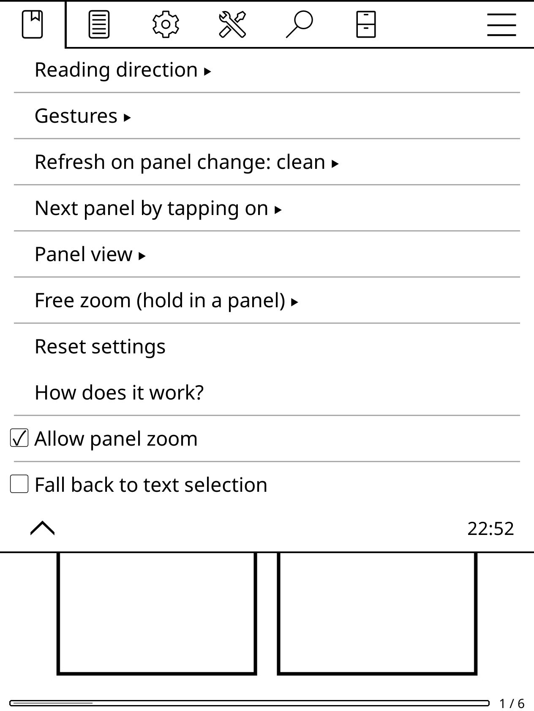
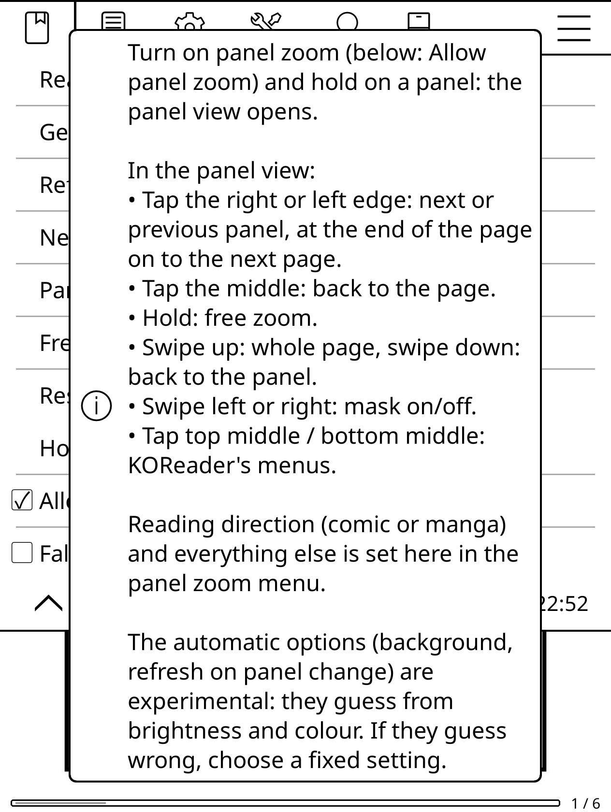
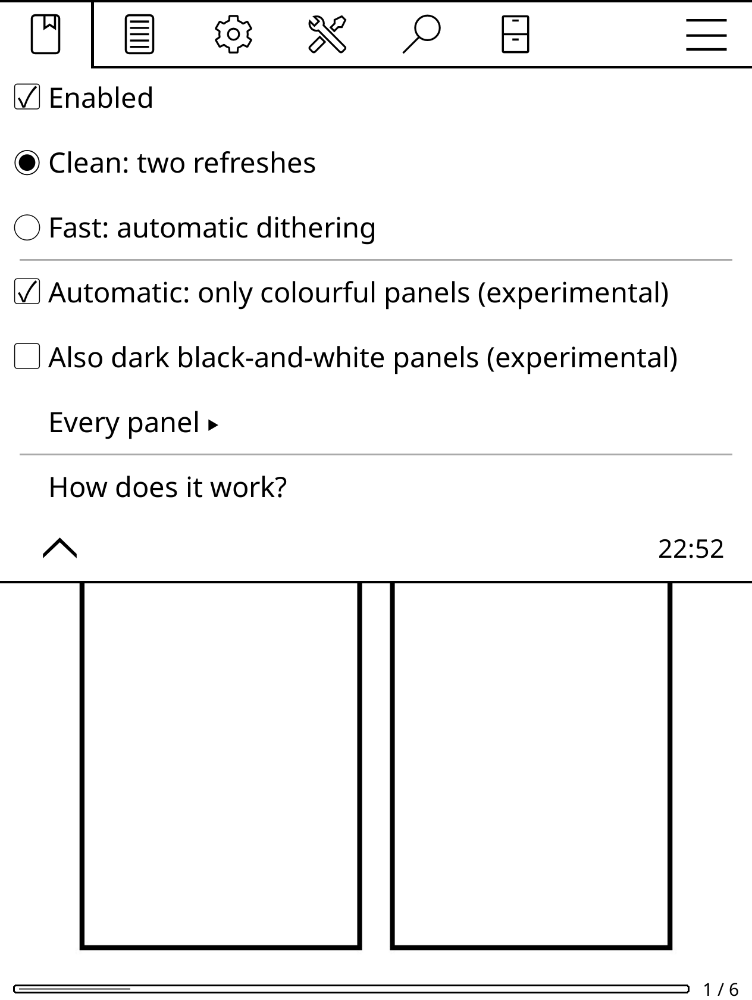
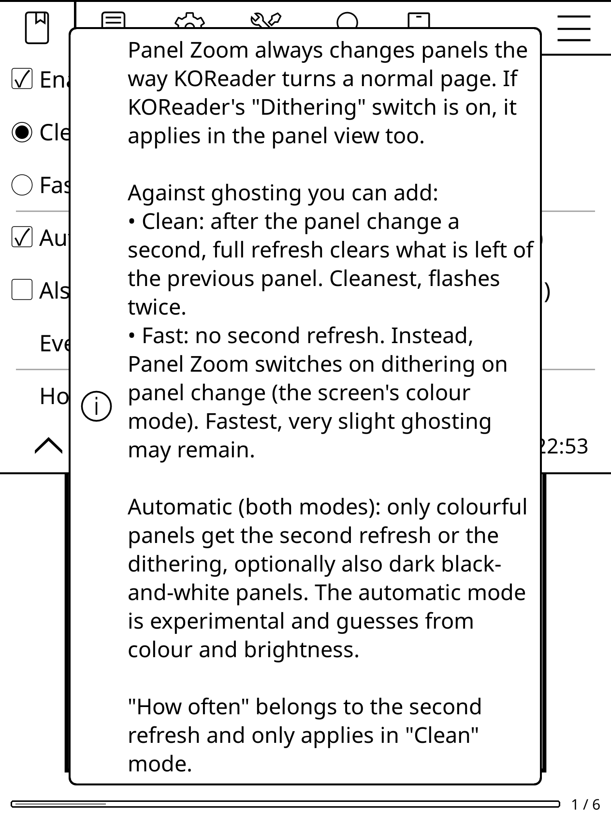
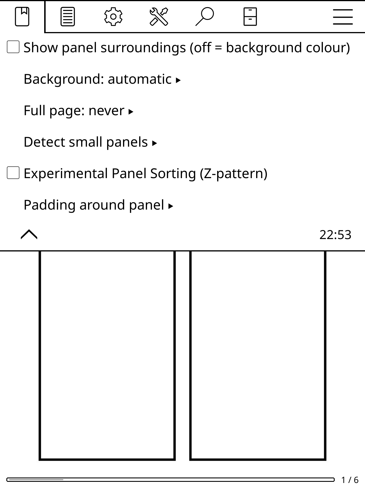

# Comic Panel Zoom for KOReader

*Deutsch: [README.de.md](README.de.md)*

<!-- lang-note -->
*Works in **English and German**: menus and texts follow KOReader's language. A German description is at the bottom of this page.*

> **Based on [Dynamic Panel Zoom](https://github.com/JorgeTheFox/koreader-dynamic-panelzoom) by [JorgeTheFox](https://github.com/JorgeTheFox)** (MIT license).
> The panel detection, the panel viewer and the basic idea all come from the original. This is an unofficial, renamed and extended version. All credit for the original plugin goes to its authors. If you like it, please star the original too.

A panel-by-panel view for comics and manga with automatic panel detection. All settings are in KOReader's normal panel zoom menu.

## What's different from the original

- It works with KOReader 2026.07.1 and later. The fix comes from the original project's code but was never released.
- It is renamed (folder, plugin name and internal module `cpz_panel_viewer.lua`), so it never collides with updates of the original.
- New features:
  - It starts at the panel you long-pressed.
  - A page overview by swiping, optionally with a frame around the current panel.
  - Mask on/off by swiping.
  - Black, white or automatic background.
  - Refresh on panel change against ghosting.
  - Reading direction per comic plus a default for new comics.
  - The full page can be shown before the first and/or after the last panel.
  - Adjustable minimum panel size.
  - KOReader's edge gestures and the [LiveLight](https://github.com/ironicsans/livelight.koplugin) plugin keep working in the panel view.
  - The menus can be opened from the panel view.
  - German menu texts.
- Bug fixes: an emergency exit (tapping the centre always closes the viewer), and panels are no longer skipped during preloading.

## Screenshots

*The screenshots show the English interface; in a German KOReader the texts are German.*

<table>
<tr><td align="center" valign="top" width="33%"> Panel zoom menu: reading direction, gestures, refresh on panel change, free zoom</td><td align="center" valign="top" width="33%"> Help text explaining the panel view and its taps</td><td align="center" valign="top" width="33%"> Refresh on panel change: clean, fast, automatic, how often</td></tr>
<tr><td align="center" valign="top" width="33%"> Help text on the two refresh modes</td><td align="center" valign="top" width="33%"> Panel view settings: surroundings, background, full page, small panels, padding</td></tr>
</table>

## Installation

1. Download the ZIP from [Releases](../../releases) and unpack it, or download this repository.
2. The following must **not** be in KOReader's `plugins` folder: the original `dynamic_panelzoom.koplugin` and PanelsPlus. All three replace KOReader's panel zoom and would overwrite each other.
3. Copy the folder **`comicpanelzoom.koplugin`** to KOReader's `plugins` folder. On a Kobo, that is `.adds/koreader/plugins/`.
4. Restart KOReader.

## Usage

1. Open a comic and set zoom to "full page" and view to "page" (not continuous).
2. Go to: top menu → document tab → Panel zoom → turn on **Allow panel zoom**. All settings are there too.
3. To open the panel view, long-press a panel.

In the panel view:

| Action | Effect |
| --- | --- |
| Tap right or left edge | Next or previous panel. At the end of the page it goes on to the next page automatically. |
| Tap the centre | Back to the page |
| Long-press | Free zoom |
| Swipe up / down | Full-page overview / back to the panel |
| Swipe left / right | Mask on/off |
| Tap top centre / bottom centre | KOReader's main menu / settings menu |
| Drag along the left or right edge | Brightness or warmth, as in normal reading |

## Settings (panel zoom menu)

- **Reading direction:** "This comic" is saved in the book, plus a "default for new comics".
- **Gestures:** overview, frame and mask swipe can each be switched off.
- **Refresh on panel change** (same layout as Comic Display): always KOReader's normal page-turn refresh, KOReader's dithering switch applies too. On top: *Clean* (second refresh: every panel, every 2nd/3rd/5th, first panel of each page) or *Fast* (automatic dithering), with automatic mode (only colourful panels, optionally dark black-and-white panels, experimental).
- **Panel view:** show surroundings, full page before and/or after the panels, minimum panel size (1/8 to 1/16 of the page), background (white, black, automatic), border.

The settings are stored in `koreader/settings/comicpanelzoom.json`, so updates of the plugin folder don't delete them.

## Works well with

- [Comic Display](https://github.com/Akrota/koreader-comic-display): refresh against ghosting and dark borders beside the page.
- [Comic Dual Page](https://github.com/Akrota/koreader-comic-dual-page): two pages side by side in landscape.

## Tested on

Kobo Libra Colour with KOReader 2026.07.1 (also with ZenOS).

## Who made this

- **Original plugin:** [JorgeTheFox](https://github.com/JorgeTheFox) and the contributors of [koreader-dynamic-panelzoom](https://github.com/JorgeTheFox/koreader-dynamic-panelzoom).
- **Changes in this version:** written entirely by **Claude**, an AI by Anthropic (in Claude Code). The owner of this repository suggested the features, tested on a Kobo and gave feedback, but did not write the code.

Please report problems with this version [here](../../issues), not to the original project. There is no warranty and no guaranteed support.

## More plugins

- [Comic Display](https://github.com/Akrota/koreader-comic-display): Refresh against ghosting, dark borders and a clock for comics
- [Levels / Tonwerte](https://github.com/Akrota/koreader-comic-levels): Tone curve for comics
- [Comic Dual Page](https://github.com/Akrota/koreader-comic-dual-page): Double pages with detection (fork of KORComic)
- [CBZ Converter](https://github.com/Akrota/koreader-cbz-converter): Convert comics, PDF and EPUB to CBZ on the device
- [Folder to series](https://github.com/Akrota/koreader-folder-to-series): Comic folders to series with volume numbers
- [Drive Library](https://github.com/Akrota/koreader-drive-library): Google Drive as a cloud library
- [Story Recall](https://github.com/Akrota/koreader-story-recall): Spoiler-free AI recap for books
- [Guitar Tab Reader](https://github.com/Akrota/koreader-guitar-tab-reader): Guitar tabs and chords for e-ink
- [Wi-Fi while charging](https://github.com/Akrota/koreader-wifi-while-charging): Keep Wi-Fi on while charging
- [Zen page browser gesture](https://github.com/Akrota/koreader-zen-page-browser-gesture): Gesture for the ZenOS page browser

## License

[MIT](LICENSE). The original copyright notice is kept unchanged.

---

## Deutsch (Kurzbeschreibung)

> **Basiert auf [Dynamic Panel Zoom](https://github.com/JorgeTheFox/koreader-dynamic-panelzoom) von [JorgeTheFox](https://github.com/JorgeTheFox)** (MIT-Lizenz).
> Die Panel-Erkennung, die Panel-Ansicht und die Grundidee stammen vom Original. Dies ist eine inoffizielle, umbenannte und erweiterte Fassung. Alle Credits für das Original-Plugin gehören seinen Autoren. Wenn es dir gefällt, gib bitte auch dem Original einen Stern.

Eine Panel-für-Panel-Ansicht für Comics und Manga mit automatischer Panel-Erkennung. Alle Einstellungen stehen im normalen Panel-Zoom-Menü von KOReader.

### Was anders ist als im Original

- Es läuft mit KOReader ab 2026.07.1. Der Fix stammt aus dem Code des Original-Projekts, wurde aber nie veröffentlicht.
- Es ist umbenannt (Ordner, Plugin-Name und internes Modul `cpz_panel_viewer.lua`) und kollidiert deshalb nie mit Updates des Originals.
- Neue Funktionen:
  - Start beim angetippten Panel.
  - Seitenübersicht per Wischen, auf Wunsch mit Rahmen um das aktuelle Panel.
  - Maske an/aus per Wischen.
  - Schwarzer, weißer oder automatischer Hintergrund.
  - Refresh beim Panelwechsel gegen Ghosting.
  - Leserichtung pro Comic plus Standard für neue Comics.
  - Ganze Seite vor dem ersten und/oder nach dem letzten Panel.
  - Einstellbare Mindestgröße für Panels.
  - KOReaders Rand-Gesten und das Plugin [LiveLight](https://github.com/ironicsans/livelight.koplugin) funktionieren auch in der Panel-Ansicht.
  - Menüs lassen sich aus der Panel-Ansicht öffnen.
  - Deutsche Menütexte.
- Fehlerbehebungen: ein Notausgang (Tipp in die Mitte schließt immer) und keine übersprungenen Panels mehr beim Vorladen.

Die ausführliche deutsche Anleitung steht in der [README.de.md](README.de.md).
